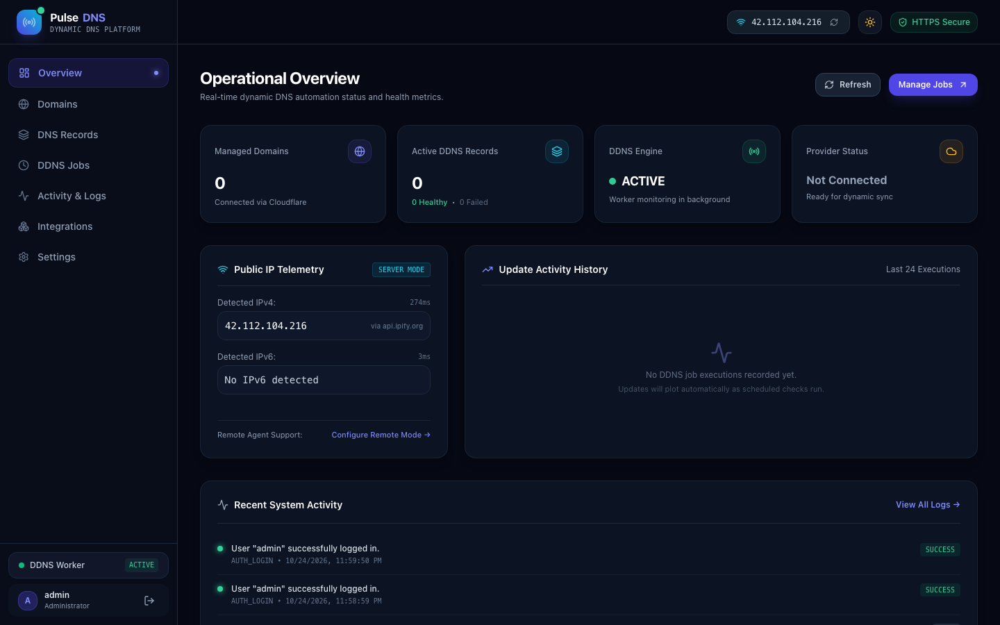
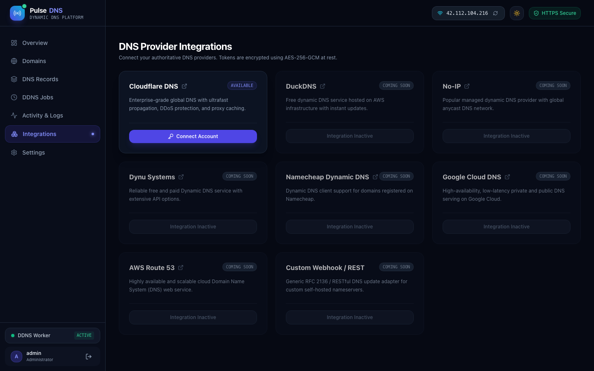
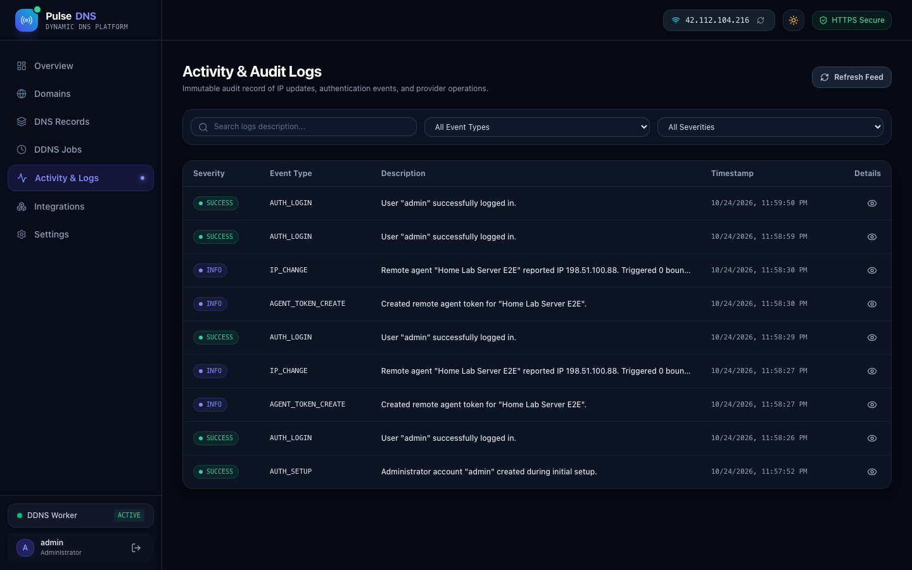
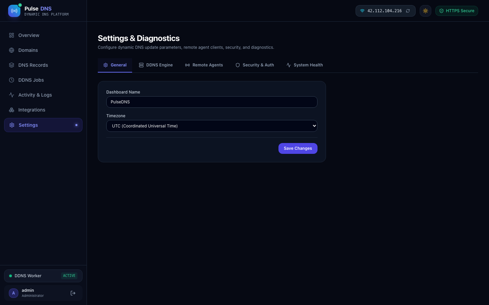
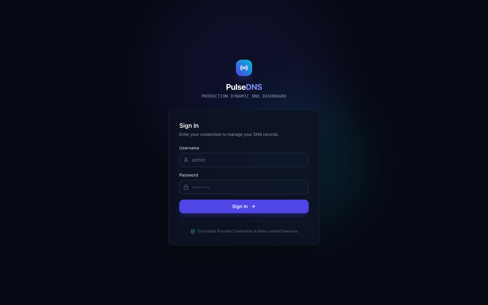

# PulseDNS — Production-Ready DDNS Management Dashboard

<p align="center">
  
</p>

**PulseDNS** is a modern, self-hosted Dynamic DNS (DDNS) management platform designed for homelabs, Linux VPS instances, and enterprise edge infrastructure. Built with Next.js 14 App Router, TypeScript, Tailwind CSS, and Prisma ORM, it features seamless **Cloudflare DNS v4** integration, an autonomous background scheduler, and a secure Remote Agent architecture.

---

## Key Highlights

- **Real Cloudflare Integration**: Powered by official Cloudflare v4 REST APIs using scoped least-privilege tokens (`Zone:Read`, `DNS:Edit`).
- **Autonomous DDNS Engine**: Operates continuously in the background even when browser tabs are closed. Checks IP changes and avoids unnecessary DNS API calls when your IP is unchanged.
- **Dual Source Modes**:
  - **Mode 1 — Server Outbound IP**: Dashboard worker automatically detects its own public IPv4 and IPv6 via redundant fallback mirrors (`ipify`, `icanhazip`, `ifconfig.me`).
  - **Mode 2 — Remote Agent / Client**: Designed for VPS deployments. Home servers or routers securely report their local public IP via cryptographically hashed bearer tokens.
- **Defense-in-Depth Security**: Provider tokens encrypted at rest with **AES-256-GCM**, passwords hashed with **bcrypt/Argon2**, HTTP-only SameSite session cookies, and zero token leakage in client responses.
- **Provider Plugin Architecture**: Clean adapter layer with Cloudflare DNS fully operational, and DuckDNS, No-IP, Dynu, Namecheap, Google Cloud DNS, AWS Route 53, and Custom Webhook adapters staged for future releases.
- **Comprehensive Observability**: Real-time IP telemetry, Recharts update activity latency graphs, structured audit logging, and Docker container healthchecks (`/api/health`).

---

## Quick Start (Local Development)

### Prerequisites
- Node.js 18+ (tested on Node 20 & 24)
- npm or pnpm

### Installation
```bash
# 1. Clone or enter directory
cd DDNS-Dashbroad

# 2. Configure environment
cp .env.example .env

# 3. Install dependencies & initialize database
npm install
npx prisma generate
npx prisma db push

# 4. Start the application
npm run dev
```

Visit [http://localhost:3000](http://localhost:3000) to initialize your master administrator account.

---

## Production Docker Deployment

Deploying PulseDNS in a homelab or VPS with Docker Compose takes seconds:

```bash
# 1. Clone repository and copy template
cp .env.example .env

# 2. Edit .env and generate secure secrets:
# openssl rand -hex 32
SESSION_SECRET="your-generated-session-secret-here"
ENCRYPTION_KEY="your-generated-64-character-hex-encryption-key"

# 3. Launch with Docker Compose
docker compose up -d --build
```

Persistent SQLite data is safely stored in `./data/pulsedns.db`.

---

## Visual Tour

<p align="center">
  
  
</p>
<p align="center">
  
  
</p>

---

## Remote Agent Setup

When PulseDNS is hosted on a VPS, configure a home server to push its IP using either reference client:

### Bash Client
```bash
PULSEDNS_URL="https://ddns.example.com" \
AGENT_TOKEN="pulse_your_secret_token" \
./scripts/pulsedns-agent.sh
```

### Python 3 Client (Zero Dependencies)
```bash
PULSEDNS_URL="https://ddns.example.com" \
AGENT_TOKEN="pulse_your_secret_token" \
python3 ./scripts/pulsedns-agent.py
```

### Systemd Timer / Crontab Example
```cron
*/5 * * * * AGENT_TOKEN="pulse_your_secret_token" PULSEDNS_URL="https://ddns.example.com" /usr/local/bin/pulsedns-agent.sh >/dev/null 2>&1
```

---

## Running the Automated Test Suite

PulseDNS includes full unit, integration, and Playwright end-to-end browser test suites:

```bash
# Run unit & integration tests (Vitest)
npm run test

# Run full end-to-end Playwright tests across Desktop and Mobile viewports
npm run test:e2e

# Capture responsive screenshots (1920px, 1440px, 768px, 390px, 375px)
npx playwright test e2e/screenshots.spec.ts --project="Desktop Chrome"
```

---

## Documentation Index

- [Architecture & Provider Plugins](ARCHITECTURE.md)
- [Production Deployment Guide](DEPLOYMENT.md)
- [Security Model & Threat Defenses](SECURITY.md)
- [Testing & Quality Verification](TESTING.md)

---

## License
MIT License. Built with pride for self-hosters and network engineers.
